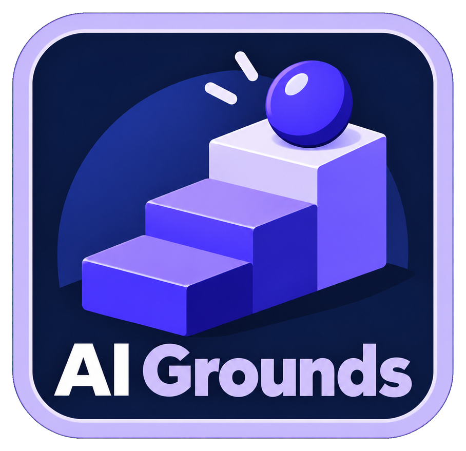

<p align="center">
  
  <br />
  <!-- repo-tagline:start -->
  <strong>🧠 Learn AI by experimenting with algorithms 🔬</strong>
  <!-- repo-tagline:end -->
  <br />
  <a href="https://aigrounds.tsilva.eu">Live Demo</a>
</p>

<p align="center">
  <a href="https://github.com/tsilva/aigrounds/actions/workflows/ci.yml"></a>
  <a href="LICENSE"></a>
</p>

AI Grounds is a collection of interactive lessons for people learning AI.
Move points, change parameters, and step through algorithms to see how they
behave.

## Learn by experimenting

Open the live playgrounds, choose a lesson from the **20-step AI core**, and
follow **Predict → Try → Explain** where offered. Try changing a threshold in
[ROC, AUC & Thresholds](https://aigrounds.tsilva.eu/playgrounds/roc-auc-thresholds)
to see how the confusion matrix and operating point respond.

Use a desktop or a wide screen for the interactive playgrounds. You can
browse lessons and read summaries on a phone. No account is required.

- [Curriculum](docs/curriculum.md) lists the core, specialist paths, and planned lessons.
- [Lesson guide](docs/lessons.md) covers experiments, tests, and progress.
- [Development](docs/development.md) and [configuration](docs/configuration.md)
  cover local checks and the optional AI Guide.

## Run locally

Use Node.js 24 (the CI version) and pnpm 10.27.0.

```bash
git clone https://github.com/tsilva/aigrounds.git
cd aigrounds
pnpm install --frozen-lockfile
pnpm dev --port auto
```

Open the local URL printed by the server.

## License

[MIT License](LICENSE).
